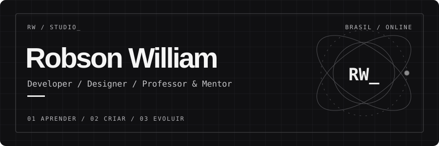
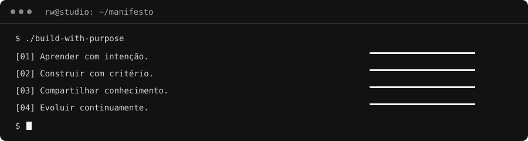

<div align="center">



[SAIBA MAIS](https://rwstudio.digital)　/　[LINKEDIN](https://www.linkedin.com/in/robson-william-rw/)

<sub>ESTRATÉGIA · CRIAÇÃO · TECNOLOGIA · MENTORIA</sub>

</div>

---

<sub>01 / IDENTIDADE</sub>

## Ideias que viram soluções. Conhecimento que vira caminho.

Sou Robson William, desenvolvedor frontend, designer, professor e mentor. Na **RW Studio**, conecto educação, estratégia e tecnologia para transformar desafios em experiências digitais e conhecimento em prática.

> A tecnologia é uma ferramenta. O conhecimento é o que nos permite criar com propósito.



<sub>02 / SISTEMA DE ATUAÇÃO</sub>

## Da ideia ao mundo real.

| `01 / EDUCATION` | `02 / DEVELOPMENT` |
| :--- | :--- |
| **Educação & mentoria** | **Sistemas & experiências digitais** |
| Orientação, autonomia e aprendizado aplicado. | Interfaces, sites e soluções web. |
| `03 / DESIGN` | `04 / INTELLIGENCE` |
| **Design & estratégia** | **Automação & IA** |
| Comunicação, direção de arte e experiência do usuário. | Integrações para simplificar processos. |

<sub>03 / TOOLKIT</sub>

## Explore meu repertório.

<details open>
<summary><b>01 / Desenvolvimento frontend</b></summary>

`HTML5` · `CSS3` · `JavaScript` · `React` · `Vue.js`

Interfaces semânticas, responsivas e acessíveis.
</details>
<details>
<summary><b>02 / Design e experiência</b></summary>

`Figma` · `Adobe XD` · `UI/UX`

Da estratégia visual à experiência de interação.
</details>
<details>
<summary><b>03 / Ferramentas e processos</b></summary>

`Git` · `Webpack` · `VS Code` · `Postman` · `Agile` · `Scrum`

Organização, colaboração e evolução contínua.
</details>
<details>
<summary><b>04 / Educação e mentoria</b></summary>

Clareza de objetivos, fundamentos, projetos práticos e desenvolvimento de autonomia.
</details>

<sub>04 / MÉTODO</sub>

## Como penso antes de construir.

```text
ENTENDER ────── PROJETAR ────── CONSTRUIR ────── EVOLUIR
    │               │               │               │
 contexto        estratégia      execução        feedback
```

<details>
<summary>Ver princípios de desenvolvimento</summary>

```yaml
rw_studio:
  mindset: learning_by_doing
  priorities:
    - semantic_html
    - accessibility
    - performance
    - clean_code
    - meaningful_design
```
</details>

<sub>05 / OPEN SOURCE ACTIVITY</sub>

## Construindo em público.

<picture>
  <source
    media="(prefers-color-scheme: dark)"
    srcset="https://raw.githubusercontent.com/robson400/robson400/output/contributions-dark.svg"
  />
  <source
    media="(prefers-color-scheme: light)"
    srcset="https://raw.githubusercontent.com/robson400/robson400/output/contributions.svg"
  />
  
</picture>

Cada contribuição é parte de um processo: experimentar, aprender, compartilhar e melhorar.

---

<div align="center">

<sub>06 / NEXT CONNECTION</sub>

## Não basta saber. É preciso criar.

Mentoria · Projetos digitais · Parcerias educacionais

[Explore meu trabalho](https://rwstudio.digital)

<sub>RW STUDIO_ / BRASIL</sub>

</div>
